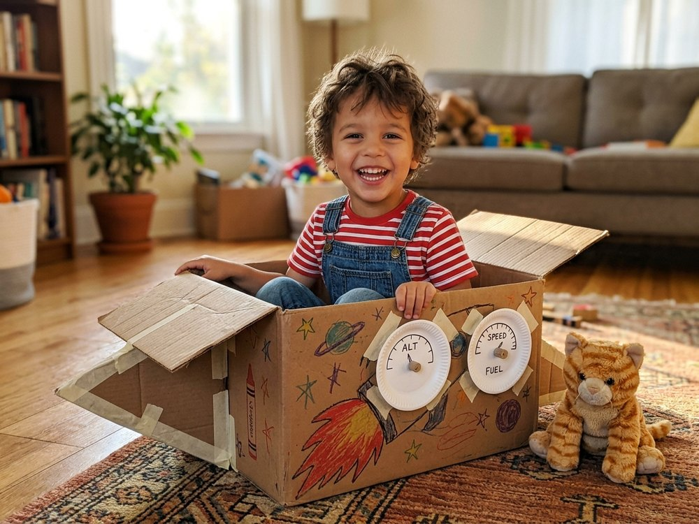
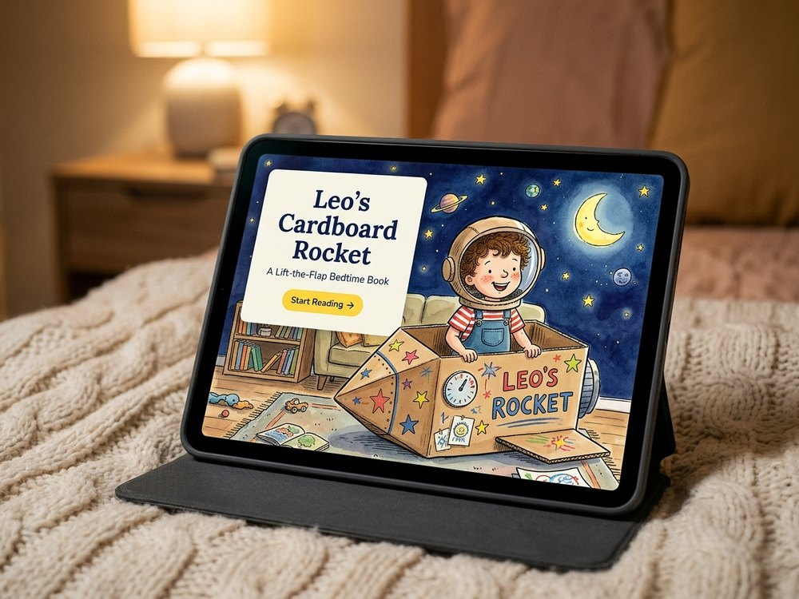

# Bedtime Book Studio 📚✨

**Turn a quick photo (or character description) and a bedtime story idea into an interactive, mobile-friendly landscape children's picture book in minutes.**

| 1. Toss your agent a photo & a story idea... | 2. ...get an interactive bedtime book on your iPad! |
| :---: | :---: |
|  |  |
| *"Leo turns a cardboard moving box in the living room into a rocket ship landing on the moon."* | **Single-file `.html` book** + **instant local Wi-Fi hosting** with interactive **Lift-the-Flap** pages |

**Bedtime Book Studio** is an open-source **Agent Skill** and **Model Context Protocol (MCP) server** that works with any AI coding/chat agent (Claude Code, Cursor, Antigravity, Windsurf, OpenClaw, etc.).

When your book finishes building, you get:
1. **A Single-File HTML Picture Book (`books/<slug>.html`)**:
   Every illustration (`.webp`), stylesheet, and interactive page-turn/flap script is bundled into **one self-contained `.html` file**. You can double-click it to open in any browser, AirDrop/text/email it straight to your phone or iPad for bedtime, or drop that single file onto any static web host.
2. **Instant Local Hosting on Your Device**:
   By default, Bedtime Book Studio automatically serves your books locally on your machine (`http://localhost:8765/<slug>/`) and prints your device's **local Wi-Fi URL** (`http://<your-lan-ip>:8765/<slug>/`) so you can open the book immediately on a phone or tablet on the same Wi-Fi network.
3. **Optional Custom Self-Hosting**:
   If you run your own web server or static site folder, you can optionally set `PUBLISH_WEB_ROOT` and `PUBLISH_BASE_URL` in `.env` to auto-copy new books to your server.

---

## ✨ Two Interactive Book Modes

1. **Lift-the-Flap Mode (`lift-the-flap` — Default)**:
   - Every story page shows the everyday **Reality** scene on a tactile, stitched cardboard flap.
   - Kids can tap the button, press `Space`/`F`, or drag the flap upward with their finger to lift it in 3D and reveal the **Imaginary** world underneath!
2. **Standard Picture-Book Mode (`standard`)**:
   - Classic single-illustration landscape spreads with big read-aloud typography, a `Aa Text Only` focus mode, and a celebratory *"Hooray! The End"* confetti finale.

---

## 🚀 Step-by-Step Setup (2 Minutes)

### Prerequisites
- **Python 3.10+**
- Any AI agent that supports **MCP** or **Skills** (and has access to an image generation tool/subagent).

### Step 1: Clone the Repo & Run Setup
```bash
git clone https://github.com/danmaps/bedtime-book-studio.git
cd bedtime-book-studio
./setup.sh
```

What `./setup.sh` does:
1. Creates a local Python virtual environment (`.venv/`) and installs `Pillow` + `mcp`.
2. Launches the **interactive onboarding wizard** to set up your main character and defaults, saving everything locally in `.env` (which is gitignored).
3. Prints the exact copy-paste config snippet for your AI agent.

> **Tip:** Want your AI agent to interview you in chat instead of using the terminal wizard? Run `./setup.sh --skip-onboard`. The first time you ask your agent to make a book, it will detect that `.env` isn't configured yet and walk you through onboarding right in chat!

---

### Step 2: Connect Your AI Agent

Choose **MCP Server**, **Agent Skill**, or both:

#### Option A: Connect via MCP (Claude Code, Cursor, Antigravity, Windsurf)
Add `bedtime-book-studio` to your agent's MCP config file (for example `~/.claude.json`, `.cursor/mcp.json`, or `~/.gemini/config/mcp_config.json`):

```json
{
  "mcpServers": {
    "bedtime-book-studio": {
      "command": "/absolute/path/to/bedtime-book-studio/.venv/bin/python",
      "args": [
        "/absolute/path/to/bedtime-book-studio/scripts/mcp_server.py"
      ]
    }
  }
}
```
*(Note: `./setup.sh` prints this exact JSON block with your real absolute paths filled in!)*

#### Option B: Connect via Agent Skill (`SKILL.md`)
Symlink the repo into your agent's skills folder:

```bash
mkdir -p ~/.agents/skills
ln -sfn "$(pwd)" ~/.agents/skills/bedtime-book-studio
```

---

### Step 3: Onboard Your Main Character (Photo and/or Text)

During onboarding (via `./setup.sh`, `python3 scripts/book_studio.py onboard`, or in chat with your agent), you configure your default character once:

- **Name & Age**: e.g. `Leo`, age `4`
- **Visual Reference (Photo, Text, or Both)**:
  - **Photo(s)**: Provide path(s) to 1 or more photos of your main character. They are copied into `./local_profile/references/` (gitignored) and automatically included as visual references in future books.
  - **Text Description & Outfit**: Describe their hair, eyes, skin tone, and signature outfit (e.g., *"4-year-old with curly brown hair, wearing a red striped T-shirt and denim overalls"*). You can use text alone or combine it with reference photos for rock-solid consistency.
- **Supporting Cast & Favorite Toys (Optional)**: Pets, siblings, parents, or favorite real-world toys that frequently appear in bedtime stories.
- **Book Defaults**: `lift-the-flap` vs. `standard` mode, default page count (`12`), and default illustration style.

All of these settings live in your local `.env` file. You can re-run onboarding anytime:
```bash
./.venv/bin/python scripts/book_studio.py onboard
```

---

## 📖 Making a Bedtime Book

Once connected, just ask your AI agent in plain English:

> *"Make a new lift-the-flap bedtime book in bold Maisy style! Here's a photo of our cardboard box (`/path/to/box.jpg`). The story is about turning a cardboard moving box in the living room into a rocket ship landing on the moon."*

### 🎨 Built-In Art Style Presets
You can set a default style preset in `.env` (`DEFAULT_STYLE_PRESET`) or pick a different style per book (`--style-preset`):

| Preset Key | Aliases | Visual Aesthetic |
| :--- | :--- | :--- |
| `watercolor-ink` *(Default)* | `watercolor`, `ink-watercolor`, `classic` | Clean hand-drawn ink linework with gentle flat watercolor washes on warm cream paper |
| `bold-gouache` | `maisy`, `bold-outlines`, `gouache` | Bold expressive black brush outlines with vibrant flat gouache colors (Maisy-inspired) |
| `claymation` | `clay`, `stop-motion`, `plasticine` | Handcrafted 3D stop-motion plasticine clay diorama with soft miniature studio lighting |
| `paper-cutout` | `collage`, `eric-carle`, `cut-paper` | Layered hand-painted tissue paper and textured cut-paper collage with crisp scissor edges |
| `crayon-storybook` | `crayon`, `pastel`, `colored-pencil` | Cozy hand-drawn wax crayon, oil pastel, and colored pencil on warm toothy paper |
| `retro-midcentury` | `retro`, `little-golden-book`, `midcentury` | 1950s mid-century Little Golden Book vintage gouache and warm lithograph print texture |

### 📝 Optional Dry-Run Planning Mode (`book-plan.md`)
Want to review or tweak the story text, page count, flap reveals, and visual prompts **before** spending time or credits generating illustrations? Ask your agent for a **dry-run book plan** (or run `plan` from the CLI):

```bash
# 1. Create a self-contained, editable Markdown plan (0 images generated, no site built yet)
./.venv/bin/python scripts/book_studio.py plan \
  --slug "leos-cardboard-rocket" \
  --title "Leo's Cardboard Rocket" \
  --idea "Leo turns a cardboard moving box in the living room into a lunar rocket ship" \
  --style-preset "bold-gouache"

# 2. Open and edit books/leos-cardboard-rocket/book-plan.md in any editor
#    (change story paragraphs, page titles, style preset, flap transformations, or visual prompts)

# 3. Apply your edits into storyboard.json + prompts.md + preview.html
./.venv/bin/python scripts/book_studio.py apply-plan --slug "leos-cardboard-rocket"
```

### What Happens Behind the Scenes:
1. **`create_book_project` / `create_book_plan`**: Scaffolds `books/<slug>/` (and optionally `books/<slug>/book-plan.md` for dry-run editing), resolving your character/pet/prop identities and chosen `style_preset`.
2. **`save_book_storyboard` / `apply_book_plan`**: Writes `storyboard.json`, `prompts.md`, and `preview.html` with locked character continuity and matching **Reality** + **Imaginary** scene prompts for every page.
3. **`ingest_generated_images`**: Your agent generates the illustrations, and Bedtime Book Studio center-crops every image to `1280x960` (4:3 landscape) and exports `.png` + `.webp`.
4. **`build_and_publish_book`**:
   - Generates the **single-file standalone HTML book** at `books/<slug>.html` (with all CSS, JS, and `.webp` images inlined so each published book is only 1 file).
   - Starts the **local device web server** so you can read immediately!

---

## 📱 Reading on Your iPad, Phone, or Computer

### 1. Recommended for iPad & Phones: Scan the Local Wi-Fi QR Code
When `publish` (or `preview`) runs, Bedtime Book Studio automatically:
- Starts a lightweight local HTTP server on port `8765` (configurable via `LOCAL_SERVER_PORT` in `.env`).
- Generates a scannable **QR code** (`books/<slug>/qr-lan.svg` + a terminal ASCII QR code in the CLI/MCP output) pointing to `http://<your-lan-ip>:8765/<slug>.html`.
- **Point your iPad or iPhone Camera app at the QR code** to open the book directly in **Mobile Safari** with full lift-the-flap touch/drag gestures, `🌙 Bedtime Mode`, and "Add to Home Screen" support.
- Need to restart the local server or print the QR code later? Run:
  ```bash
  ./.venv/bin/python scripts/book_studio.py serve
  ```

### 2. Single-File HTML Book (`books/<slug>.html`)
- Every published book is a single, completely self-contained `books/<slug>.html` file (~1.5–5 MB total, with all `.webp` illustrations, CSS, and JS embedded).
- **On Mac / PC / Android**: Double-click `books/<slug>.html` to open in any desktop browser with full interactivity.
- **Static Hosting**: Drag-and-drop `books/<slug>.html` onto Netlify Drop, Cloudflare Pages, GitHub Pages, S3, or any static host for a permanent HTTPS link you can text to family.

### 📊 Verified iPad & Mobile Delivery Matrix

> [!IMPORTANT]
> **Why iPadOS Files / AirDrop `.html` attachments don't run Lift-the-Flap JavaScript:**
> When you open a local `.html` file inside the iPadOS **Files**, **Mail**, or **Messages** app, iOS renders it inside a sandboxed **QuickLook preview** (`QLPreviewController`) that disables JavaScript and custom touch-drag events—and iPadOS does not provide an *"Open local file in Safari"* button from Files.
> **For iPad and iPhone, always use Local Wi-Fi (QR code) or an HTTPS static host so the book opens in Mobile Safari.**

| Delivery Method | Target Browser / Viewer | Lift-the-Flap Drag & Tap | Page Turns & Bedtime Mode | Offline Support |
| :--- | :--- | :---: | :---: | :--- |
| **1. Local Wi-Fi QR Code (`http://<lan-ip>:8765/<slug>.html`)** | **iPadOS / iOS Mobile Safari** | ✅ Full | ✅ Full | Same Wi-Fi LAN (or cached tab) |
| **2. Self-Hosted / Static Host (`https://.../<slug>.html`)** | **iPadOS / iOS Mobile Safari** | ✅ Full | ✅ Full | Cached after first load |
| **3. Desktop Browser (`file:///.../books/<slug>.html`)** | **macOS / Windows / Linux Browser** | ✅ Full | ✅ Full | ✅ 100% Offline |
| **4. AirDrop / iPadOS Files `.html` Attachment** | **iOS QuickLook (`QLPreviewController`)** | ⚠️ Disabled by iOS sandbox | ⚠️ Static layout only | Offline static view only |

### 🔧 Local Wi-Fi & Port Troubleshooting
- **iPad can't reach `http://<lan-ip>:8765`?**
  1. Ensure your computer and iPad are on the **same Wi-Fi network** (avoid "Guest" Wi-Fi networks that enable AP client isolation).
  2. If macOS/Linux firewall prompts to allow incoming connections for Python, click **Allow** (or open TCP port `8765` via `ufw allow 8765/tcp`).
  3. If port `8765` is already in use, pass `--port 8888` to `publish` / `serve` or set `LOCAL_SERVER_PORT="8888"` in `.env`.

### 3. Optional Custom Self-Hosting (`PUBLISH_WEB_ROOT`)
If you run a local or remote web server directory (Nginx, Caddy, Tailscale Serve, etc.), set these optional variables in `.env`:
```env
PUBLISH_WEB_ROOT="/var/www/my-site/books"
PUBLISH_BASE_URL="https://example.com/books"
```
Whenever a book is published, Bedtime Book Studio will automatically copy the single-file book into `<PUBLISH_WEB_ROOT>/<slug>.html` and return `<PUBLISH_BASE_URL>/<slug>.html`.

---

## Optional Bookshelf

[The bookshelf template](templates/bookshelf.html) is a single HTML file with a black background and a responsive, scrollable grid of cover thumbnails. Tap a cover to read its book in an iframe, then use **Back to shelf** to return to the same shelf position.

Ask your agent: *"Set up the optional bookshelf with my books."* Agents can find the instructions in [AGENTS.md](AGENTS.md).

To populate it yourself:

1. Copy `templates/bookshelf.html` to `books/index.html` (or your chosen hosting folder).
2. Find the `BOOK PATHS` comment. Copy its example link outside the comment for each book, setting `href` to the single-file book HTML (`<slug>.html`) and `src` to its inlined `data:image/webp;base64,...` cover URI (or cover image path). Set `alt` to the book's name for accessibility.
3. Serve the shelf and single-file books together using your local or static hosting. With the existing local server serving `books/`, open `http://<your-lan-ip>:8765/index.html` on your phone or tablet.

The template is optional and starts as an empty black page until you add links. It shows only covers, with no visible title, captions, or metadata. Comments mark places for optional decoration: ask your agent afterward to add a kid's name, theme colors, or another personal touch.

---

## 🛠️ CLI & MCP Tool Reference

| MCP Tool | CLI Command | Description |
| :--- | :--- | :--- |
| `get_onboarding_status` | `book_studio.py status` | Check if `.env` onboarding is complete and get onboarding instructions |
| `configure_studio` | `book_studio.py onboard` / `configure` | Save character photo(s), text description, outfit, style preset, and defaults to `.env` |
| `list_art_style_presets` | `book_studio.py style-presets` | List built-in art style presets (`watercolor-ink`, `bold-gouache`, `claymation`, etc.) and aliases |
| `get_studio_profile` | `book_studio.py profile` | View the active character, identities, and studio configuration |
| `list_identities` | `book_studio.py identities` | List persistent characters, siblings, pets, and props (`local_profile/identities.json`) |
| `upsert_identity` | `book_studio.py upsert-identity` | Create/update an entity with a stable ID (`char-...`, `pet-...`, `prop-...`) and reality vs. imaginary rules |
| `manage_identity_reference` | `book_studio.py identity-ref` | Add, relabel, or include/exclude (`--active false`) an individual reference photo |
| `list_existing_books` | `book_studio.py list` | List all generated books, `book-plan.md` files, single-file HTML paths, preview sheets, and local URLs |
| `create_book_project` | `book_studio.py init` | Scaffold a new book project with selected `cast_ids`, `style_preset`, and per-book `entity_overrides` |
| `create_book_plan` | `book_studio.py plan` | Dry-run mode: create an editable `books/<slug>/book-plan.md` with layout, narrative, and visual direction |
| `apply_book_plan` | `book_studio.py apply-plan` | Parse an edited `book-plan.md` into `storyboard.json`, `prompts.md`, and `preview.html` |
| `save_book_storyboard` | `book_studio.py storyboard` | Validate & normalize `storyboard.json`, transformation mappings, and reference-chained `prompts.md` |
| `validate_book_storyboard` | `book_studio.py validate` | Validate `storyboard.json` against canonical schema and optionally check required image assets (`--require-assets`) |
| `generate_book_preview` | `book_studio.py preview` | Generate `preview.html` contact sheet, alignment inspector, and Local Wi-Fi QR code (`qr-lan.svg`) |
| `ingest_generated_images` | `book_studio.py ingest` | Center-crop images to 4:3 (`1280x960`), export `.png` + `.webp`, and archive prior versions |
| `revise_book_page` | `book_studio.py revise` | Revise one page (`text-only`, `reality-only`, `imaginary-only`, `paired-scene`) without touching approved art |
| `approve_book_assets` | `book_studio.py approve` | Mark storyboard and/or specific illustration assets as approved |
| `rollback_book_asset` | `book_studio.py rollback` | Restore a prior archived version of an illustration from `assets/history/` |
| `get_revision_status` | *(in `revision_state.json`)* | Inspect approval state, version history, and revision log for a book |
| `build_and_publish_book` | `book_studio.py publish` | Validate assets, atomically build single-file `<slug>.html` + multi-file reader, generate `qr-lan.svg`, and serve locally |
| *(CLI helper)* | `book_studio.py serve` | Start or check the local device HTTP server and print the Local Wi-Fi QR code |

---

## 🔒 Privacy by Design

- `.env`, `local_profile/`, and `books/` are all gitignored in [`.gitignore`](.gitignore).
- Your personal family photos, character names, and generated books never leave your device unless you choose to share them.

---

## 📄 License

MIT License — see [LICENSE](LICENSE).
